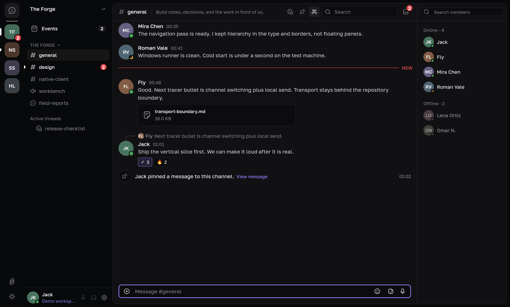

# Flucord

Flucord is a native Discord desktop client built with Flutter. It runs without
Electron or an embedded browser. It is a [Redstone](https://redstone.md)
project by Rxflex.

> [!IMPORTANT]
> Flucord is not affiliated with Discord. It uses Discord's private client
> protocol, which can change at any time, and a third-party client may break
> Discord's terms of service.



## Download

Windows x64 builds are on the
[releases page](https://github.com/redstone-md/flucord/releases). Each release
has an installer, a portable ZIP and a `SHA256SUMS.txt` file.

To sign in, open **Connections**, choose **Sign in with QR code** and scan the
code with the Discord mobile app. Flucord keeps the session in the Windows
credential vault.

## What works

Flucord has chat, threads, forums and DMs, voice and video calls, screen share,
friends, profiles and the member list. It also has notifications, keybinds,
Rich Presence and themes. We test on Windows.

Some features are partial, and some have not been checked against the official
client yet. [The feature parity table](docs/FEATURE_PARITY.md) lists the
status of each one.

## Build from source

You need Flutter 3.44 or newer, Visual Studio 2022 with the C++ desktop
workload, and the WebView2 Runtime.

```powershell
flutter pub get
flutter run -d windows
```

To try the interface with demo data and no account, add
`--dart-define=FLUCORD_DEMO_MODE=true`.

Before you open a pull request, run `flutter analyze`, `flutter test` and
`.\tool\audit_public_repository.ps1`. Planned work is in
[roadmap.md](roadmap.md), and the other docs are in [docs/](docs).

## License

Flucord is source-available under the
[Flucord Project License 1.0](LICENSE). You may use, change and distribute it
if you give credit, publish your source and keep the same license. You may not
reuse the interface outside Flucord or its forks. This is not an OSI-approved
open source license.
